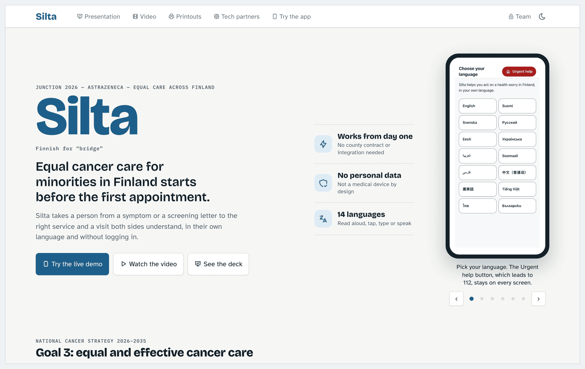
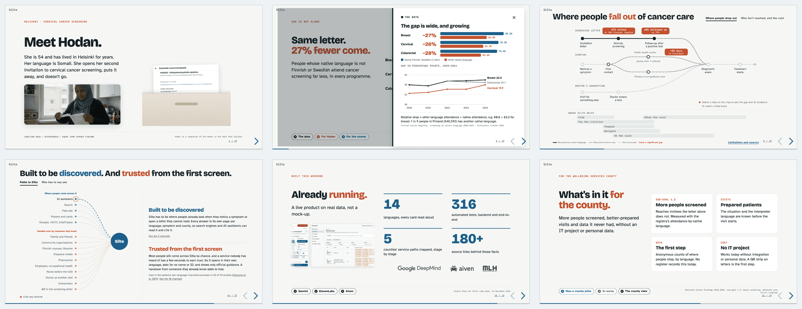
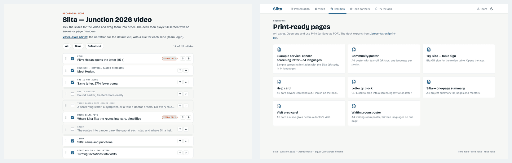
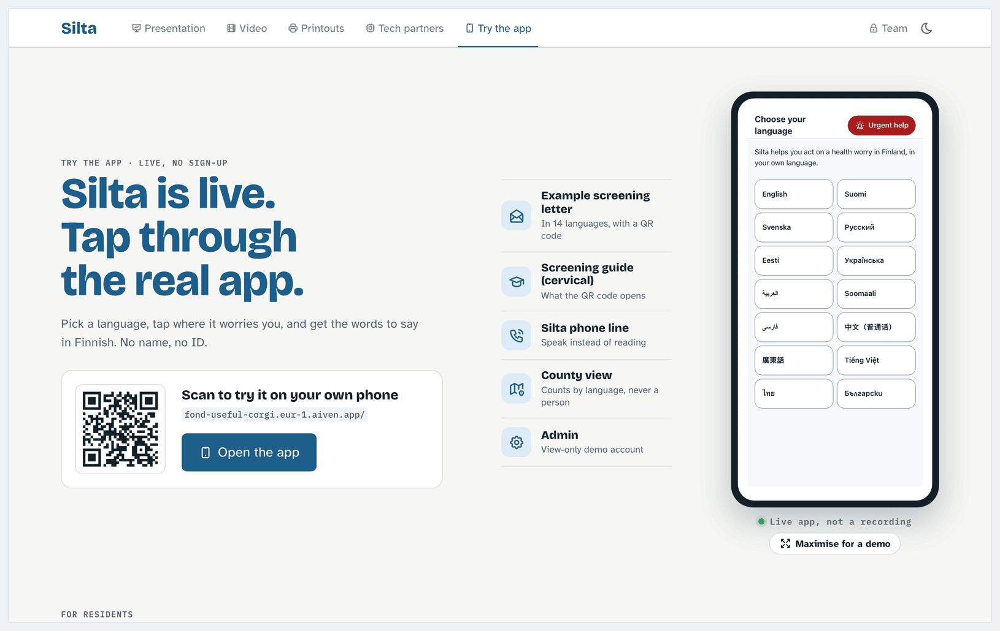
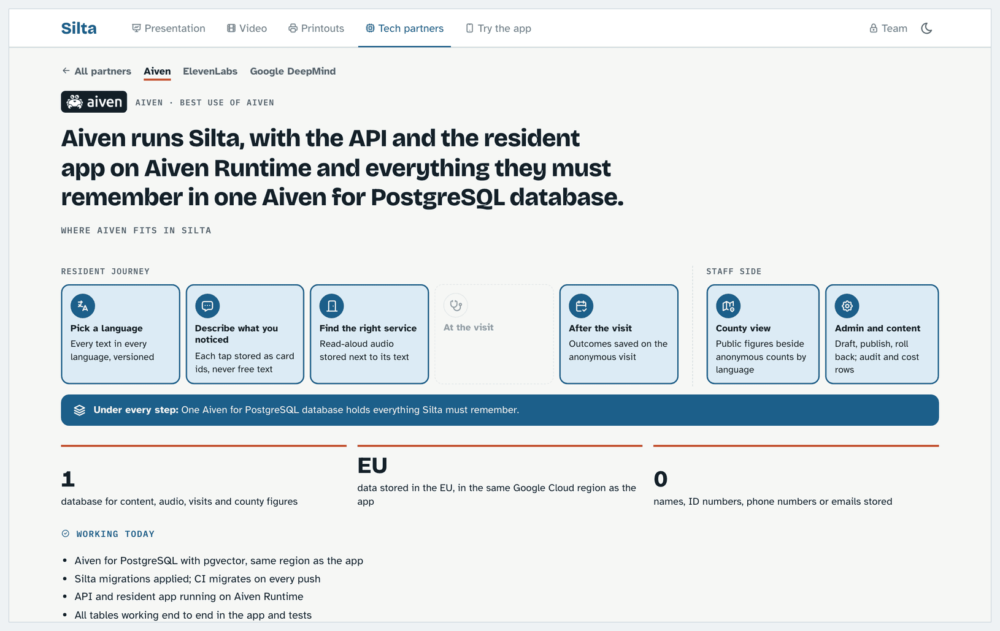
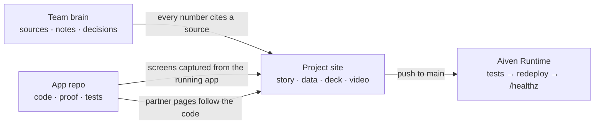

# Silta — project site

**One repository, one push: the story, the data behind every number, the deck, the video and
the live app, on one site.**

This is the site judges and partners open first for **Silta**, our Junction 2026 build for
AstraZeneca's *Equal Care Across Finland*. Silta takes a person from a cancer symptom or a
screening letter to the right service, in their own language and without logging in.

**[Open the site](https://mostly-awaited-flounder.eur-1.aiven.app)** ·
[Deck](https://mostly-awaited-flounder.eur-1.aiven.app/presentation) ·
[Video](https://mostly-awaited-flounder.eur-1.aiven.app/video) ·
[Try the app](https://mostly-awaited-flounder.eur-1.aiven.app/try) ·
[Tech partners](https://mostly-awaited-flounder.eur-1.aiven.app/tech) ·
[Printouts](https://mostly-awaited-flounder.eur-1.aiven.app/printouts) ·
[App code](https://github.com/madviking/junction2026tech)



## What is on the site

| Page | What a visitor gets | URL |
| --- | --- | --- |
| Landing | The punchline, a phone slider of real app screens, how Silta meets Goal 3 of the National Cancer Strategy, where it fits on the routes into care, and why it is safe to use today | [`/`](https://mostly-awaited-flounder.eur-1.aiven.app) |
| Deck | 17 interactive slides with drill-in sheets, live charts and the pathway map | [`/presentation`](https://mostly-awaited-flounder.eur-1.aiven.app/presentation) |
| Video | The pitch video, under two minutes, cut from the same deck | [`/video`](https://mostly-awaited-flounder.eur-1.aiven.app/video) |
| Try the app | The live resident app running inside the page, a QR code for your own phone, and every other way in | [`/try`](https://mostly-awaited-flounder.eur-1.aiven.app/try) |
| Tech partners | One page each for Aiven, ElevenLabs and Gemini | [`/tech`](https://mostly-awaited-flounder.eur-1.aiven.app/tech) |
| Printouts | Example screening letters in 14 languages, posters, help and visit-prep cards, all with QR codes | [`/printouts`](https://mostly-awaited-flounder.eur-1.aiven.app/printouts) |
| Team | Internal shelf: plans, analyses, scripts, video assets (password) | `/team` |

## The deck: reveal.js, written as data



The deck follows two people, Hodan with a screening letter and Olga with a symptom, from the
letter in the drawer to the visit. A judge who only reads the headlines gets the story; every
number has a sheet behind it.

- **One YAML file is the deck.** `content/presentation-v3.yaml` holds the text, numbers, sources
  and speaker notes of all 17 slides. One template (`app/templates/presentation_v3.html`) renders
  12 layouts on top of [reveal.js](https://revealjs.com) 5.1.0. Writers and agents edit content;
  nobody touches HTML to change a slide.
- **Glance first, then drill down.** Each slide makes one point. The chips in its footer open 27
  side sheets of four kinds: *the person*, *the county*, *in euros* and *the data*, each with its
  source.
- **Charts that build up.** Gap bars, trend lines and the routes map draw themselves each time
  their slide or sheet is shown.
- **The pathway slide is an app.** Three routes into cancer care, the gap at each step and where
  Silta helps, from `content/data/pathway.json`. Click a step for its evidence level, tables and
  Plotly charts (`app/charts/`, one module per chart, data in `content/data/` with a named source).
- **Real screens, moving.** The "Already running" slide spins a reel of screens captured from the
  live app and its admin, not mock-ups.
- **PDF for the inbox.** `/presentation?print-pdf` lays the deck out for print and adds a link from
  every slide to its interactive version online (`node scripts/export_deck_pdf.mjs`).

## The video, recorded from the deck



- **Recording mode.** `/presentation/record` opens a slide picker: tick, drag to reorder, then the
  deck plays full screen with no arrows, page numbers or progress bar, and the pointer hides. The
  cut lives in the address (`?slides=a,b,c`), so the same take can be reproduced
  (`content/presentation-video.yaml`).
- **Film slides.** Video-only slides play one clip filling the frame with an animated lower third,
  then fade into the next deck slide.
- **Motion graphics from code.** `scripts/video/scenes.html` defines the animated scenes in the
  deck's design system; `render.mjs` steps through them frame by frame with Playwright and a
  short Swift encoder (`encode.swift`, macOS AVFoundation) writes the MP4s. No ffmpeg, no
  After Effects.
- **Real screens, generated footage, both labelled.** App screens in Somali and English are
  captured from the live app (`scripts/video/capture.mjs`). Footage with a person in it was
  generated with Google AI Studio; that person is not a real resident, and Hodan is a composite
  (`content/materials/video-assets/README.md`).

## Live app demo, inside the site



`/try` runs the real resident app in a phone frame on the page. Judges tap through it without
leaving the site, scan the QR code to continue on their own phone, or press **Maximise for a
demo** on a shared screen. Below it, one card per way in: the screening letter in 14 languages,
the picture guide its QR code opens, the phone line with its keypad menu, the county view and the
admin with a view-only demo account. All links come from `content/site.yaml` and can be pointed
at another deployment with `SILTA_<KEY>_URL` variables.

## Tech-partner pages



Each partner's judges see within a minute how their technology fits. The top of the page is drawn
from frontmatter in `content/tech-challenges/<slug>.md`: the resident journey with the partner's
steps lit and the others greyed out, up to three numbers and what is live today. The Markdown body
becomes collapsed panels: how Silta uses it, architecture, what is live, why it matters. Every
claim points to a file in the app repo or a proof in `docs/proof/` there.

## How we worked



- **Three repositories, three jobs.** The team brain ([junction2026](https://github.com/madviking/junction2026))
  holds research: sources, dated notes and decisions. The app lives in
  [junction2026tech](https://github.com/madviking/junction2026tech). This repo turns both into
  something a judge can take in, and it is the default home for anything made for the team to look at.
- **Every public number has a trail.** Each data file names its brain source in
  `content/data/README.md`; slides and sheets carry their source line. Wording stays as careful as
  the source.
- **Content is files, edited by people and agents.** Slides, pages, partner pages and printouts are
  YAML and Markdown. [`AGENTS.md`](AGENTS.md) is the shared manual for Claude Code, Codex and
  humans: where each artefact goes, how to add a chart, and the house style. Glance first, then
  drill down; concrete nouns and real numbers; no hype words.
- **Screens are captured, never mocked.** Six Playwright scripts in `scripts/` recapture the phone
  screens, deck screens, admin views and video screens from the running app, signed in as the
  view-only demo account when they need admin. When the app changes, the site follows with one
  command.
- **A shelf for the team.** `/team` lists every internal artefact with its description and date, plus links to work that lives elsewhere (claude.ai artifacts, Docs) from
  `content/materials/_links.yaml`. It fails closed: without a password configured it answers 503.
- **Push is publish.** Every push to `main` runs the 65 tests, then redeploys on Aiven Runtime and
  waits for `/healthz` (`.github/workflows/deploy.yml`). Before judging, whatever is on `main` is
  what judges see.

## Stack

FastAPI and Jinja, server-rendered; [Tabler](https://tabler.io) 1.0.0 UI kit with Silta's own CSS;
reveal.js 5.1.0 for the deck; Plotly for charts; segno for QR codes; Python-Markdown and PyYAML for
content. One Docker image, no database, writes nothing to disk. Exact pins in `requirements.txt`;
CDN assets pinned to exact versions.

## Run locally

```bash
cp .env.example .env
make up          # Docker on http://localhost:8400, edits to content/ and app/ show on reload
```

Without Docker: `make install && make dev`. Tests: `make test`.

| Page | URL |
| --- | --- |
| Landing page | `/` |
| Deck (PDF export: `?print-pdf`) | `/presentation` |
| Video cut of the deck | `/presentation/record` |
| Pathway slide (bare page: `/presentation/pathway`; archive: `/pathway/archive`) | `/presentation#/pathway` |
| Video | `/video` |
| Printouts | `/printouts` |
| Try the app | `/try` |
| Tech-partner pages | `/tech`, `/tech/<slug>` |
| Team materials (password when hosted) | `/team` |

Rebuild the screenshots in this README from a running site:
`SITE_URL=https://... bash scripts/readme_images.sh` (Playwright from `../tech/frontend`,
ImageMagick).

## Host on Aiven Runtime

Aiven Runtime builds the `Dockerfile` from this repository using `compose.aiven.yaml`.
The container serves plain HTTP on 8400, Aiven terminates TLS and serves it on HTTPS 443.
The image writes nothing to disk and needs no database.

One-time setup (Aiven project `appzio-d111`, the same as the app backend):

1. Push this repository's `main` to GitHub (`madviking/junction2026-presentation`).
2. Aiven Console → Runtime → Deploy application → GitHub account `madviking`,
   repository `junction2026-presentation`, branch `main`, manifest **`compose.aiven.yaml`**.
   Live since 2026-11-14: application `site`, Google Cloud `europe-west4` (Netherlands; Runtime
   offered no Finland region), plan Startup-20-512 (~$12/month),
   https://mostly-awaited-flounder.eur-1.aiven.app
3. Application → environment variables:

   | Variable | Value |
   | --- | --- |
   | `TEAM_PASSWORD` | shared team password (password manager). Without it `/team` answers 503. |
   | `SILTA_SITE_URL` | this application's public URL (used by printout QR codes) |
   | `SILTA_CONSUMER_URL`, `SILTA_COUNTY_URL`, `SILTA_ADMIN_URL` | the deployed app's URLs, once it is deployed |

4. Check `https://<public-url>/healthz` answers `ok` and `/team` asks for the password.

### Automatic deploys

Aiven Runtime does not deploy on push by itself. `.github/workflows/deploy.yml` runs the tests
on every push to `main` and then calls the Aiven API endpoint behind the console's
**Deploy latest commit** button. It needs one repository secret, `AIVEN_TOKEN`:

1. Aiven Console → user menu (top right) → **Tokens** → Generate token. Give it a description
   (`github deploy junction2026-presentation`) and a session duration that covers the event.
2. Store it without showing it: `gh secret set AIVEN_TOKEN -R madviking/junction2026-presentation`
   and paste the token at the prompt.

Manual fallback: Runtime → `site` → **Deploy latest commit**, or GitHub → Actions → deploy →
Run workflow.

Content (texts, slides, charts, materials) is baked into the image, so a content change goes
live with the deploy that follows its push (a few minutes). Before judging, stop pushing
changes you have not checked: whatever is on `main` is what judges see.

## Host on any Docker host

```bash
TEAM_PASSWORD=... SILTA_SITE_URL=https://... docker compose up -d --build
```

`compose.yaml` binds `127.0.0.1:8400`; put it behind the host's TLS proxy, or set
`SITE_BIND=0.0.0.0`. Health check: `/healthz`.

## Edit

Everything editable is under `content/`. See [AGENTS.md](AGENTS.md) for what goes where and
how to add a chart.

## Team

Timo Railo (Dad), Milla Railo (Big Sister), Mea Railo (Little Sister)
